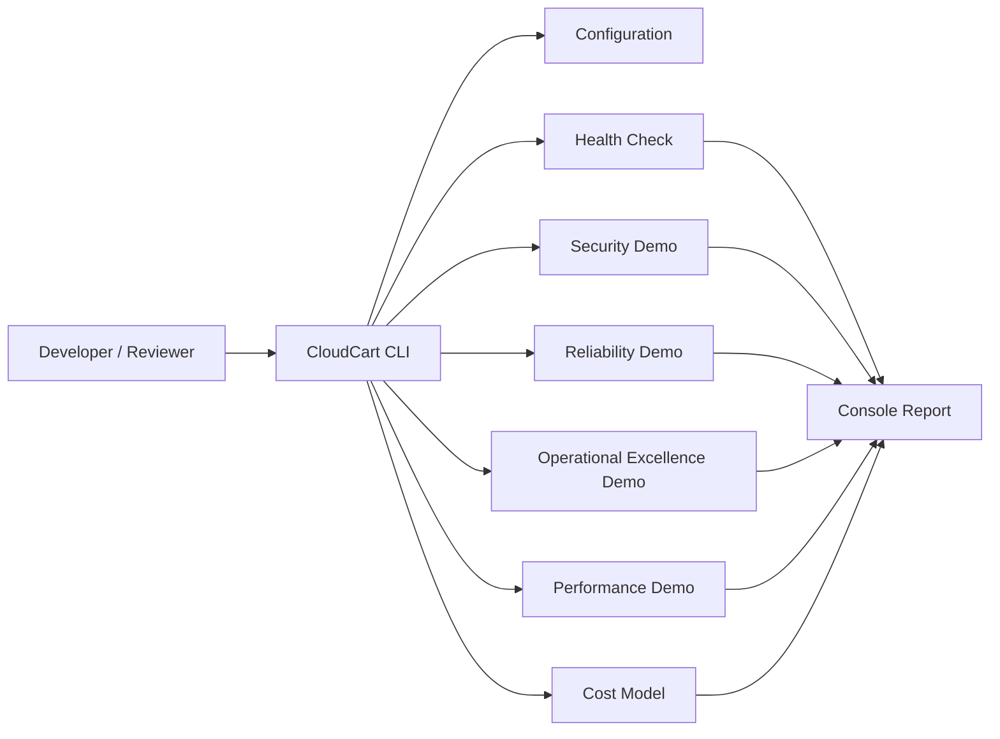

# CloudCart — AWS Well-Architected Portfolio

CloudCart is a local-first portfolio project that demonstrates how an e-commerce application can be designed around the five pillars of the AWS Well-Architected Framework.

> **Scope and cost:** This repository is designed to run locally using Python's standard library. It does not create AWS resources, and it does not prove that a real AWS deployment is secure, resilient, performant, or cost-optimized. Any future AWS deployment should go through a separate cost, security, and architecture review.

## What it demonstrates

| Pillar | Local demonstration | What it does not claim |
|---|---|---|
| Security | Input validation, safe configuration handling, redacted logging example, basic security checks | No real IAM, VPC, KMS, WAF, or AWS security posture |
| Reliability | Health checks, simulated dependency failure, retry with bounded attempts | No multi-AZ failover or production SLA |
| Operational Excellence | Structured logs, diagnostic status, incident simulation | No CloudWatch, Systems Manager, or live alerting |
| Performance Efficiency | Small benchmark harness and cached/uncached example | No production load test or AWS scaling result |
| Cost Optimization | Transparent cost estimate from editable assumptions and budget threshold check | No AWS billing integration or guarantee of zero AWS charges if deployed |

## Requirements

- Python 3.10 or newer (tested design uses standard-library features only)
- Git (optional but recommended)

## Run locally on Windows PowerShell

From the extracted project folder:

```powershell
py --version
py -m app
```

Run the tests:

```powershell
py -m unittest discover -s tests -v
```

Run a pillar demonstration:

```powershell
py -m app --pillar all
py -m app --pillar security
py -m app --pillar reliability
py -m app --pillar operations
py -m app --pillar performance
py -m app --pillar cost
```

No third-party package installation is required.

## Project structure

```text
CloudCart-Portfolio/
├── app/
│   ├── __init__.py
│   ├── __main__.py
│   ├── main.py
│   ├── config.py
│   ├── health.py
│   ├── security.py
│   ├── reliability.py
│   ├── operations.py
│   ├── performance.py
│   └── cost.py
├── tests/
│   ├── test_health.py
│   ├── test_security.py
│   ├── test_reliability.py
│   ├── test_performance.py
│   └── test_cost.py
├── docs/
│   ├── architecture.md
│   ├── security-and-threat-model.md
│   ├── operations-runbook.md
│   ├── cost-model.md
│   └── portfolio-talk-track.md
├── .gitignore
└── README.md
```

## Architecture overview



## Example output

```text
CloudCart — AWS Well-Architected Portfolio
Mode: local simulation (no AWS API calls)

[SECURITY] PASS - input validation rejects unsafe values
[RELIABILITY] PASS - health status and bounded retry behavior verified
[OPERATIONS] PASS - diagnostic event emitted with correlation ID
[PERFORMANCE] INFO - local benchmark completed; not a production load test
[COST] INFO - illustrative estimate calculated from editable assumptions
```

Exact timing values will vary by machine.

## Git checkpoint

After you review the extracted project and run the tests:

```powershell
git status
git add .
git commit -m "Build CloudCart Well-Architected portfolio demos"
```

If you are merging these files into an existing repository, inspect `git status` first and do not overwrite any work you want to keep.

## Portfolio presentation checklist

- [ ] Run the full test suite and capture terminal output.
- [ ] Run `py -m app --pillar all` and capture output.
- [ ] Review the architecture and threat-model docs.
- [ ] Add your own screenshots and a short project walkthrough.
- [ ] If publishing to GitHub, check for secrets and personal information first.
- [ ] Clearly label the project as a local simulation unless you later build and verify a real AWS environment.
