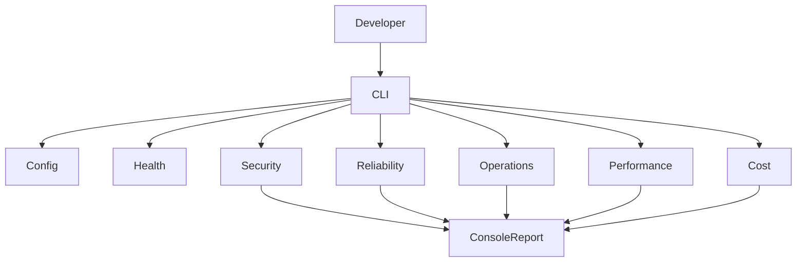

# Architecture and Design

## Purpose
CloudCart is a local-first teaching application that demonstrates design thinking for the five AWS Well-Architected pillars. It intentionally avoids cloud SDKs and AWS API calls so the repository can be explored without deploying infrastructure.

## Components
- **CLI (`app/main.py`)**: selects and runs a pillar demonstration.
- **Configuration (`app/config.py`)**: reads a small allowlist of environment settings and validates values.
- **Health (`app/health.py`)**: reports whether required application metadata is valid.
- **Security (`app/security.py`)**: validates a sample order ID and demonstrates masking an email.
- **Reliability (`app/reliability.py`)**: aggregates dependency health and retries a simulated operation with bounded attempts.
- **Operations (`app/operations.py`)**: emits a JSON diagnostic event with a correlation ID.
- **Performance (`app/performance.py`)**: runs a small local cache microbenchmark.
- **Cost (`app/cost.py`)**: estimates costs from explicit, editable assumptions and compares the estimate with a budget.

## Data flow
A developer runs the CLI. The CLI validates configuration, checks basic health, invokes the selected demonstration, and prints a concise summary. No network calls or persistent customer data are used.

## Future AWS mapping (design proposal only)
| Concern | Possible AWS service | Validation required before deployment |
|---|---|---|
| Identity and access | IAM | Least-privilege policy review, role assumption test |
| Network isolation | VPC, security groups | Threat model and ingress/egress review |
| Encryption | KMS, service-side encryption | Key policy, rotation, data classification |
| Monitoring | CloudWatch | Metrics, dashboards, alarm tests |
| Compute | Lambda or ECS | Workload benchmark, scaling, resilience test |
| Data | DynamoDB or RDS | Access patterns, backup/restore test |
| Budget visibility | AWS Budgets, Cost Explorer | Account permissions, billing data, notification configuration |

These are candidate mappings, not implemented resources.

## Architecture diagram

